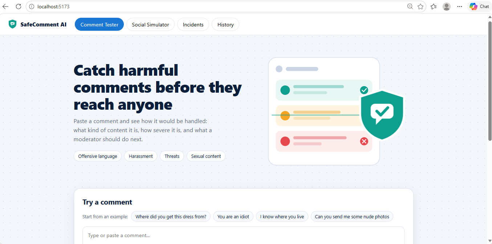
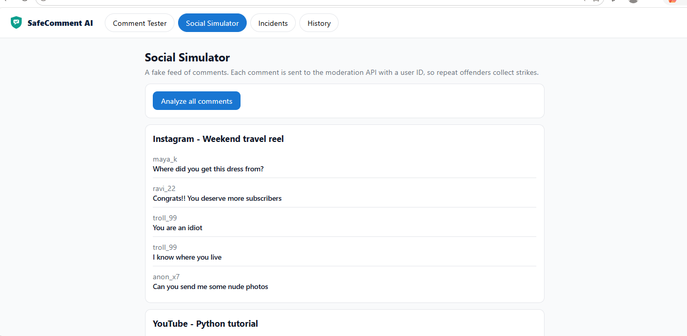
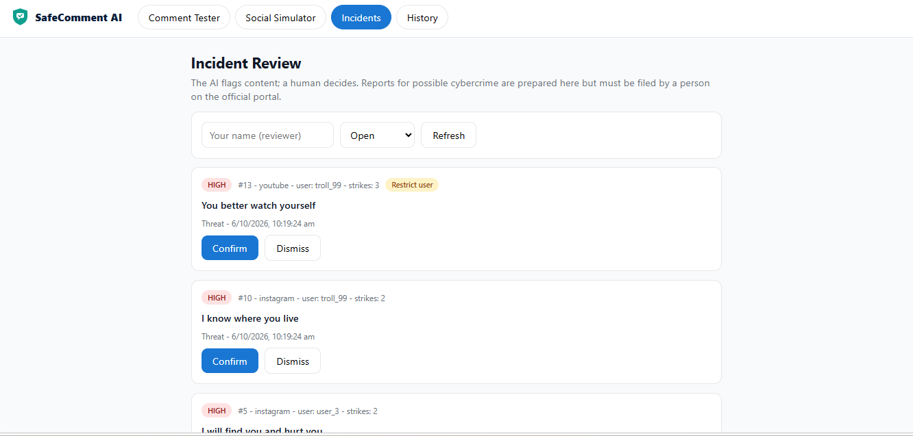
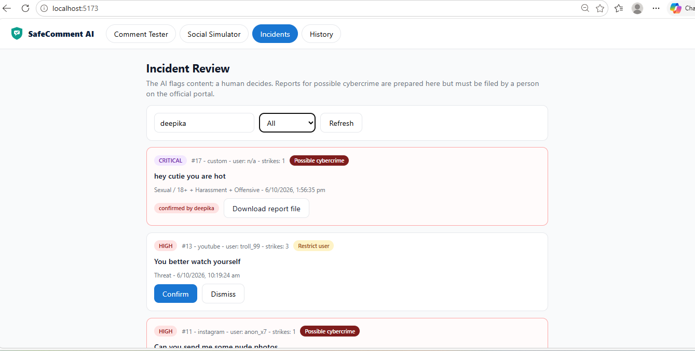
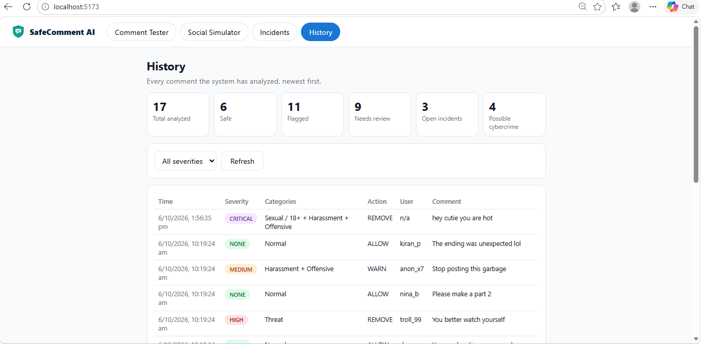
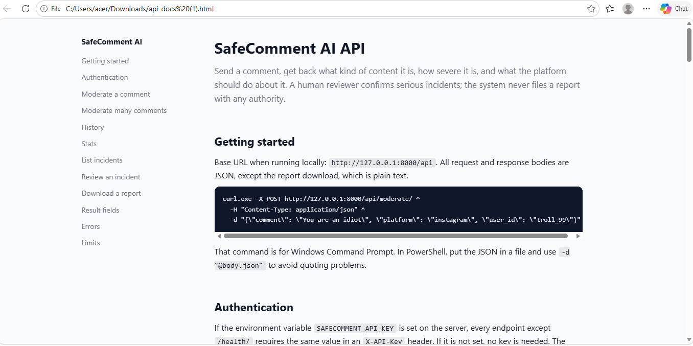
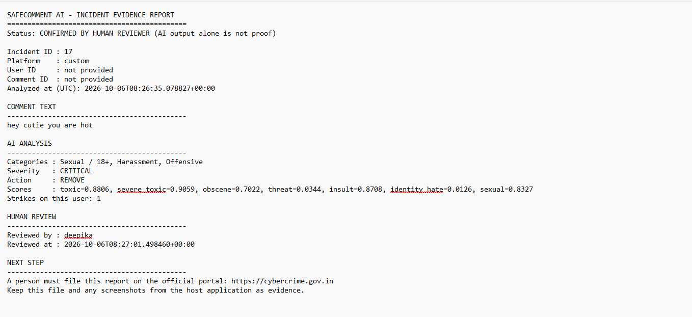

# SafeComment AI

SafeComment AI is a comment moderation system. It reads a comment, works out what kind of content it is (normal, offensive, harassment, threat or sexual), rates how severe it is, and recommends an action. Serious cases become incidents that a human reviewer confirms or dismisses. The system never reports anyone to an authority by itself.



## What it does

- **Classifies comments** into Normal, Offensive, Harassment, Threat and Sexual / 18+, with a severity from NONE to CRITICAL.
- **Decides an action** (allow, warn or remove) and counts strikes for repeat offenders, using a `user_id` you send with each comment.
- **Opens incidents** for removed comments, so a person can review them.
- **Prepares an evidence file** for confirmed sexual-content incidents. A person must file it themselves on the official portal (https://cybercrime.gov.in).
- **Exposes a JSON API**, documented in [`docs/api_docs.html`](docs/api_docs.html), so any platform could plug it in.

## Why a human stays in the loop

The model is a triage aid, not a judge. On a hand-written test it scored 61.0% (see [Accuracy](#accuracy)), so it makes mistakes. For that reason:

1. The AI flags and recommends.
2. A human reviewer confirms or dismisses each incident, and their name and time are recorded.
3. Only confirmed, possible-cybercrime incidents can produce a report file.
4. A human files any complaint. Nothing is submitted automatically.

## Screenshots

| Social Simulator | Incident review |
|---|---|
|  |  |

| Confirmed incident with report download | History and stats |
|---|---|
|  |  |

| API documentation | Evidence report file |
|---|---|
|  |  |

## Project structure

```
ai-comment-moderation/
  backend/     Django API (api/views.py, urls.py, policies.py, models.py)
  frontend/    React + Vite dashboard (src/)
  ml/          Training scripts and the moderator (moderator.py, test_moderator.py)
  data/        Training and test datasets
  models/      Trained model files
  docs/        API documentation and screenshots
  requirements.txt
```

## Setup (Windows, PowerShell)

You need Python 3.10 or newer and Node.js 18 or newer.

### 1. Python environment

```powershell
python -m venv venv
.\venv\Scripts\Activate.ps1
pip install -r requirements.txt
```

### 2. Trained models

The `models/` folder must contain the trained models. If it is empty, train them first (the training data is in `data/`):

```powershell
python ml/train_toxicity.py
python ml/train_sexual.py
```

### 3. Database and backend

```powershell
cd backend
python manage.py migrate
python manage.py runserver
```

The API runs at http://127.0.0.1:8000. Keep this terminal open.

### 4. Frontend

In a second terminal:

```powershell
cd frontend
npm install
npm run dev
```

Open http://localhost:5173. The dev server forwards `/api` requests to the Django backend.

### Optional: API key

To require a key on every API call, set it before starting both servers:

```powershell
$env:SAFECOMMENT_API_KEY = "choose-a-secret"
```

When it is set, every endpoint except `/api/health/` needs the header `X-API-Key: choose-a-secret`. The dashboard's dev server adds the header for you.

## Using the dashboard

1. **Comment Tester**: type or pick a comment and click *Analyze comment* to see the category, severity, action and scores.
2. **Social Simulator**: click *Analyze all comments* to run a fake feed through the API. Repeat offenders collect strikes.
3. **Incidents**: enter your name as reviewer, then confirm or dismiss each open incident. Confirmed sexual-content incidents get a *Download report file* button.
4. **History**: every analyzed comment, with totals.

## API

Base URL: `http://127.0.0.1:8000/api`

| Method | Endpoint | Purpose |
|---|---|---|
| POST | `/moderate/` | Analyze one comment |
| POST | `/moderate-batch/` | Analyze up to 100 comments |
| GET | `/history/` | Past analyses, with filters |
| GET | `/stats/` | Dashboard totals |
| GET | `/incidents/` | Removed comments awaiting review |
| POST | `/incidents/{id}/review/` | Confirm or dismiss an incident |
| GET | `/incidents/{id}/report/` | Download the evidence file (confirmed possible-cybercrime incidents only) |
| GET | `/health/` | Server check |

Example:

```powershell
$body = '{"comment": "You are an idiot", "platform": "instagram", "user_id": "troll_99"}'
Invoke-RestMethod -Method Post -Uri http://127.0.0.1:8000/api/moderate/ -ContentType "application/json" -Body $body
```

Full details are in [`docs/api_docs.html`](docs/api_docs.html).

## Accuracy

Three measurements, each on data further from what the system was built around:

| Test | Accuracy |
|---|---|
| Before tuning | 81.2% |
| First unseen set | 70.7% |
| Final unseen set: 41 hand-written comments, run once, not tuned against | 61.0% |

An earlier held-out set later scored 100%, but its failures had been fixed, so it no longer counts as unseen and is not a real-world figure.

With only 41 comments, the final result has wide uncertainty: roughly 46% to 74%.

Reproduce the final test with:

```powershell
python ml/test_moderator.py data/test_final.csv
```

The script groups ABUSIVE and HARASSMENT labels with OFFENSIVE and NORMAL with SAFE, because the moderator decides between those categories using score combinations.

## Limitations

The final test shows where the system fails:

- **Repeated-contact harassment**: comments like "Stop tagging me in every single video" were all treated as safe (0 of 6 caught). They are only harassment when the same person keeps doing it, and the model reads one comment at a time. The strike counter helps only partly.
- **Veiled threats**: "Keep talking and you'll regret it" and similar comments contain no violent keywords and were missed.
- **Soft sexual requests**: "You look hot, send something private" was missed. This matters most, because the report file only exists for sexual-content incidents that reach a reviewer.
- **Criticism versus insults**: "Your content is getting worse" is arguably fair criticism, so labels disagree here.
- **Threat score is slightly flattering**: two of the threats it caught ("I know where you live", "You better watch yourself") overlap rules written earlier.
- **Small test set**: 41 comments is enough to find weaknesses, not to give a precise accuracy.

It never wrongly flagged a normal comment in this test, but it let many harmful ones through. Treat it as a triage aid.

## Not built yet

- Connecting a real Instagram professional account through Meta's official API (comments on your own account only, through the platform's permissions).
- Per-user history in the model itself, to catch repeated harassment.
- Retraining on comments collected from permitted sources, anonymized and labelled by hand.

## Notes on data and privacy

- Comments should be anonymized before they are saved for training.
- Never collect comments by scraping. Use the platforms' official APIs and check their terms.
- Keep access tokens and API keys out of the repository (add `.env` to `.gitignore`).
